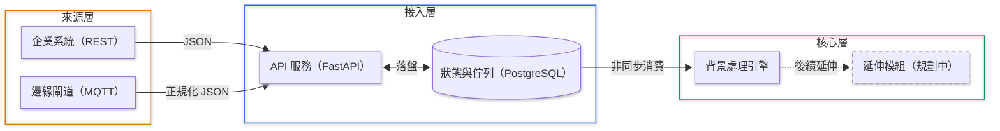
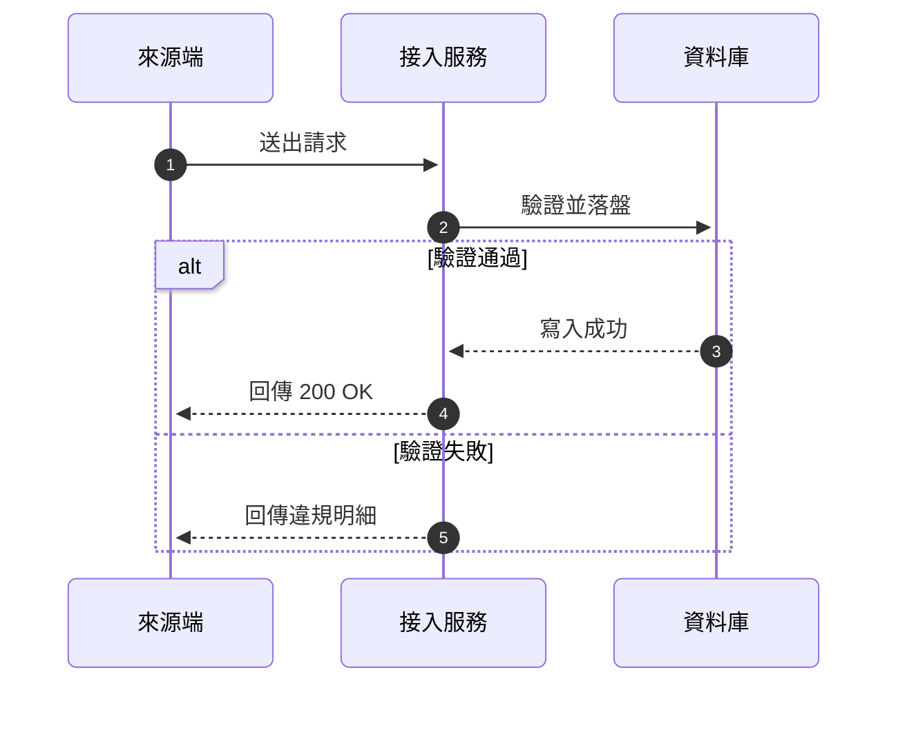
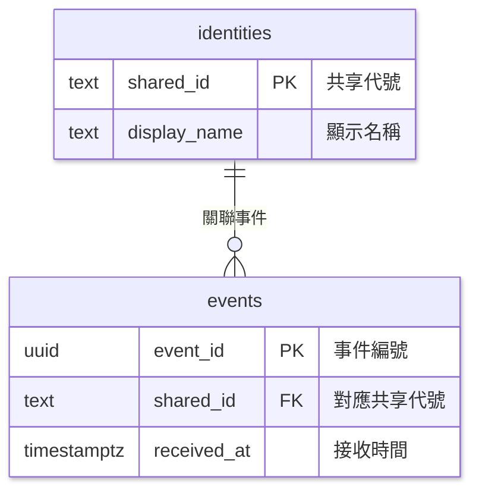
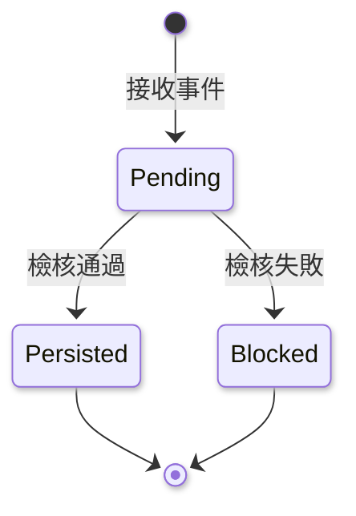

# Mermaid 現代圖表範本與語意邊框參考

本檔收錄符合深／淺色原生主題切換的各類 Mermaid 範本。所有範本均不使用寫死的背景填色或字色，僅於 `subgraph` 採透明底（`fill:transparent`）搭配語意色邊框。

## 目錄

- [建議語意邊框色票](#建議語意邊框色票)
- [分層系統架構圖（flowchart LR）](#分層系統架構圖flowchart-lr)
- [端對端時序圖（sequenceDiagram）](#端對端時序圖sequencediagram)
- [實體關聯圖（erDiagram）](#實體關聯圖erdiagram)
- [狀態機圖（stateDiagram-v2）](#狀態機圖statediagram-v2)
- [品牌靜態雙圖切換（HTML picture）](#品牌靜態雙圖切換html-picture)

## 建議語意邊框色票

以下中等明度語意色在深色（`#18181B`）與淺色（`#FFFFFF`）畫布上皆具足夠對比，僅用於 `stroke` 邊框：

| 語意層級 | 色碼 | 適用場景 |
| --- | --- | --- |
| 琥珀（Amber） | `#D97706` | 外部來源、閘道、邊緣設備、警告 |
| 藍（Blue） | `#2563EB` | API 介面、接入層、核心關聯儲存 |
| 紫（Violet） | `#7C3AED` | 語意引擎、推論核心、領域邏輯 |
| 綠（Emerald） | `#059669` | 協同服務、知識輸出、通過狀態 |
| 灰（Slate） | `#64748B` | 保留原庫、延伸未實作項目（搭 `stroke-dasharray: 5 5`） |

## 分層系統架構圖（flowchart LR）



## 端對端時序圖（sequenceDiagram）



## 實體關聯圖（erDiagram）



## 狀態機圖（stateDiagram-v2）



## 品牌靜態雙圖切換（HTML picture）

若圖表需要固定品牌色票而非跟隨主題，於 GitHub Markdown 使用標準 `<picture>` 搭配 `prefers-color-scheme`：

```html
<picture>
  <source media="(prefers-color-scheme: dark)" srcset="assets/architecture-dark.svg">
  <source media="(prefers-color-scheme: light)" srcset="assets/architecture-light.svg">
  
</picture>
```
